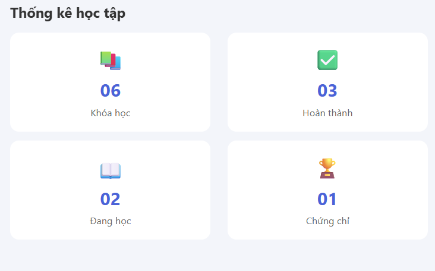
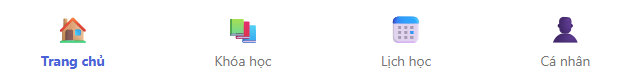

# BÀI THỰC HÀNH 02 - REACT NATIVE

## 1. Thông tin ứng dụng

- Tên ứng dụng: LearningApp
- Họ và tên: Huy Trần
- Nền tảng: Expo Snack
- Chủ đề: Ứng dụng quản lý học tập

## 2. Link ứng dụng Expo

- LearningApp: https://snack.expo.dev/@huy228/learningapp

## 3. Cấu trúc thư mục

```text
LearningApp/
├── App.js
└── components/
    ├── Header.js
    ├── StatCard.js
    ├── CourseCard.js
    └── BottomMenu.js
```

## 4. Nội dung các Component

### 4.1. Header

- Hiển thị lời chào sinh viên.
- Hiển thị họ tên và thông tin sinh viên.

Code sử dụng: View, Text, StyleSheet.

### 4.2. StatCard

- Hiển thị thống kê khóa học.
- Số lượng khóa học.
- Số khóa học đã hoàn thành.
- Số khóa học đang học.
- Số chứng chỉ.

Code sử dụng: View, Text, StyleSheet và Props.

### 4.3. CourseCard

- Hiển thị danh sách môn học.
- Tên môn học và giảng viên.
- Thanh tiến độ học tập.

Code sử dụng: View, Text, StyleSheet và Props.

### 4.4. BottomMenu

- Hiển thị thanh menu cuối màn hình.
- Trang chủ, Khóa học, Lịch học, Cá nhân.

Code sử dụng: View, Text, StyleSheet.

## 5. File App.js

Sử dụng import để gọi 4 Component:
- Header
- StatCard
- CourseCard
- BottomMenu

Kết hợp ScrollView để hiển thị nội dung
và View để bố trí giao diện trang Home.

## 6. Hình ảnh giao diện

### 6.1. Giao diện trang Home


### 6.2. Component Header


### 6.3. Component StatCard



### 6.4. Component CourseCard


### 6.5. Component BottomMenu



## 7. Kết luận

Hoàn thành bài thực hành xây dựng trang Home
bằng React Native.

Đã biết cách tạo và sử dụng Component,
truyền dữ liệu bằng Props, sử dụng StyleSheet
và tổ chức các Component trong thư mục components.
