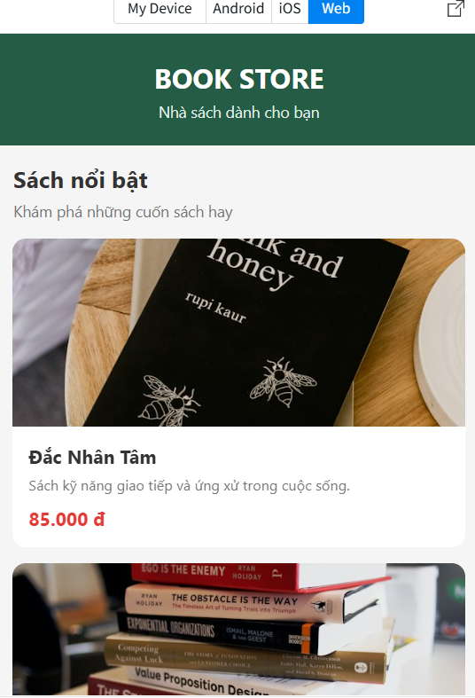

# BÀI THỰC HÀNH 03 - REACT NATIVE

## 1. Thông tin ứng dụng

- Tên ứng dụng: ProductApp
- Họ và tên: Huy Trần
- Chủ đề: Ứng dụng bán sách
- Nền tảng: Expo Snack

## 2. Link ứng dụng Expo

- ProductApp: https://snack.expo.dev/@huy228/productapp

## 3. Cấu trúc thư mục

```text
ProductApp/
├── App.js
└── components/
    └── ProductCard.js
```

## 4. Nội dung thực hành

### 4.1. Component ProductCard

- Hiển thị hình ảnh sản phẩm.
- Hiển thị tên sản phẩm.
- Hiển thị giá sản phẩm.
- Hiển thị mô tả sản phẩm.
- Nhận dữ liệu thông qua Props.

### 4.2. File App.js

- Khai báo danh sách 6 sản phẩm.
- Sử dụng FlatList để hiển thị sản phẩm.
- Sử dụng ProductCard để hiển thị từng sản phẩm.
- Truyền dữ liệu sản phẩm bằng Props.

### 4.3. Các thành phần sử dụng

- View: Bố trí giao diện.
- Text: Hiển thị nội dung.
- Image: Hiển thị hình ảnh sản phẩm.
- FlatList: Hiển thị danh sách sản phẩm.
- StyleSheet: Thiết kế giao diện.

## 5. Hình ảnh giao diện

### 5.1. Giao diện chính



### 5.2. Component ProductCard


### 5.3. Danh sách 6 sản phẩm


## 6. Kết luận

Hoàn thành bài thực hành xây dựng ứng dụng
bán sách bằng React Native.

Biết cách tạo Component ProductCard,
truyền dữ liệu bằng Props và sử dụng FlatList
để hiển thị danh sách sản phẩm.
