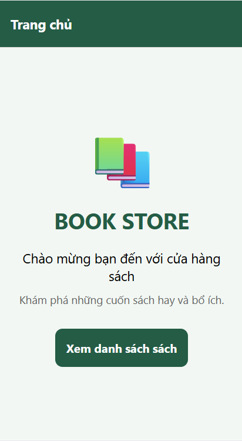
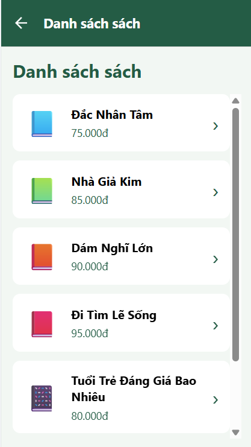
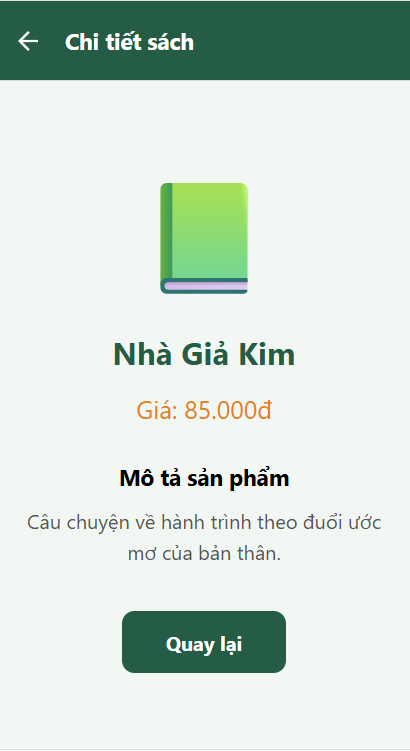

# BÀI THỰC HÀNH 04 - REACT NATIVE

## 1. Thông tin ứng dụng

- Tên ứng dụng: MultiScreenApp
- Họ và tên: Huy Trần
- Chủ đề: Ứng dụng giới thiệu sách
- Nền tảng: Expo Snack

## 2. Link ứng dụng Expo

- MultiScreenApp:https://snack.expo.dev/@huy228/multiscreenapp

## 3. Cấu trúc thư mục

```text
MultiScreenApp/
├── App.js
└── components/
    ├── HomeScreen.js
    ├── ListScreen.js
    └── DetailScreen.js
```

## 4. Nội dung các màn hình

### 4.1. HomeScreen

- Hiển thị lời chào.
- Giới thiệu cửa hàng sách.
- Có nút chuyển đến danh sách sách.

### 4.2. ListScreen

- Hiển thị danh sách 6 cuốn sách.
- Hiển thị tên và giá sách.
- Chọn một cuốn sách để xem chi tiết.

### 4.3. DetailScreen

- Hiển thị tên sách.
- Hiển thị giá sách.
- Hiển thị mô tả sách.
- Có nút quay lại màn hình trước.

## 5. Công nghệ sử dụng

- React Native
- React Navigation
- Stack Navigation
- View, Text, TouchableOpacity
- FlatList
- StyleSheet

## 6. Hình ảnh giao diện

### 6.1. Màn hình HomeScreen



### 6.2. Màn hình ListScreen



### 6.3. Màn hình DetailScreen



## 7. Kết luận

Hoàn thành bài thực hành xây dựng ứng dụng nhiều màn hình bằng React Native.

Đã biết cách tạo HomeScreen, ListScreen, DetailScreen và sử dụng Stack Navigation để chuyển đổi giữa các màn hình.
