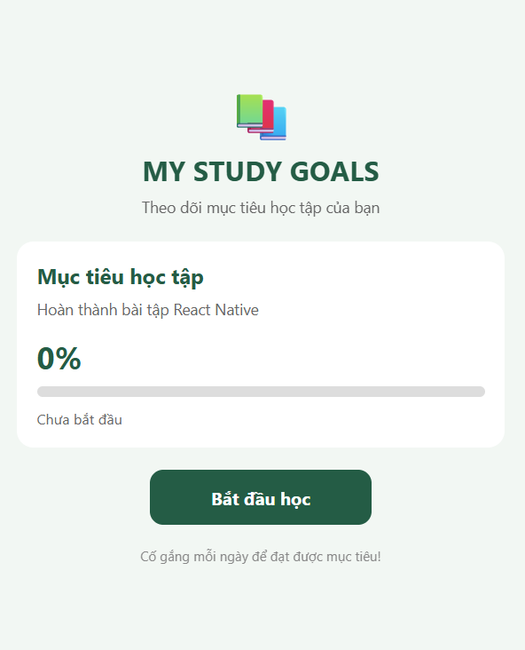
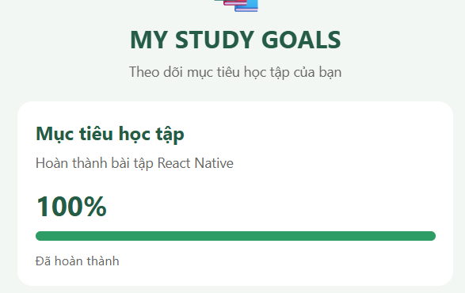
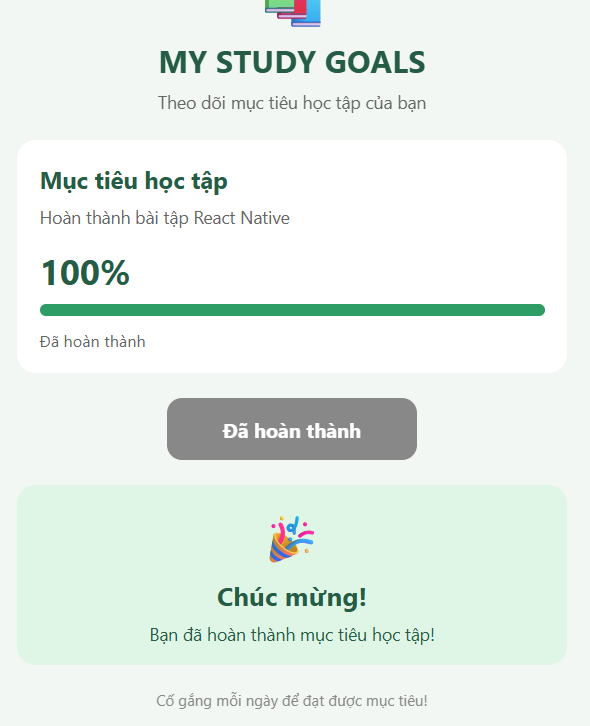

# BÀI THỰC HÀNH 05 - REACT NATIVE

## 1. Thông tin ứng dụng

- Tên ứng dụng: AnimateApp
- Họ và tên: Huy Trần
- Chủ đề: Ứng dụng theo dõi mục tiêu học tập
- Nền tảng: Expo Snack

## 2. Link ứng dụng Expo

- AnimateApp: https://snack.expo.dev/@huy228/animateapp

## 3. Cấu trúc thư mục

```text
AnimateApp/
├── App.js
└── components/
    ├── ProgressCard.js
    ├── ActionButton.js
    └── AnimatedMessage.js
```

## 4. Nội dung các component

### 4.1. ProgressCard

- Hiển thị mục tiêu học tập.
- Hiển thị phần trăm tiến độ.
- Có thanh tiến độ thay đổi khi hoàn thành.

### 4.2. ActionButton

- Hiển thị nút Bắt đầu học.
- Khi nhấn nút, tiến độ được cập nhật.
- Khi hoàn thành, nút đổi trạng thái.

### 4.3. AnimatedMessage

- Hiển thị thông báo hoàn thành.
- Sử dụng Animated để tạo hiệu ứng.
- Thành phần xuất hiện với hiệu ứng phóng to và di chuyển.

## 5. Công nghệ sử dụng

- React Native
- View, Text
- TouchableOpacity
- StyleSheet
- useState, useEffect, useRef
- Animated

## 6. Hình ảnh giao diện

### 6.1. Giao diện ban đầu



### 6.2. Thẻ tiến độ



### 6.3. Thông báo hoàn thành



## 7. Kết luận

Hoàn thành bài thực hành xây dựng ứng dụng AnimateApp bằng React Native.

Đã biết cách tách component, theo dõi tiến độ học tập và sử dụng Animated để tạo hiệu ứng cho thành phần giao diện.
