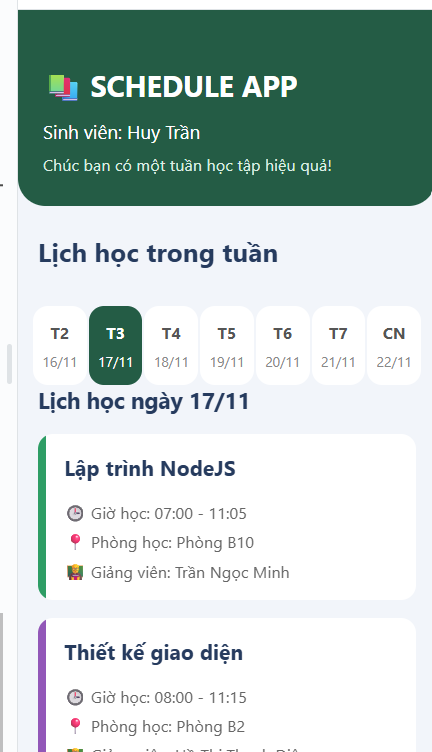
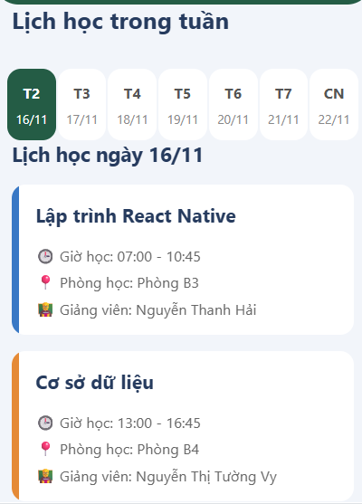
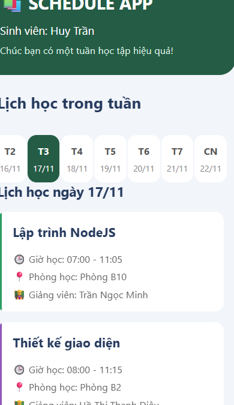
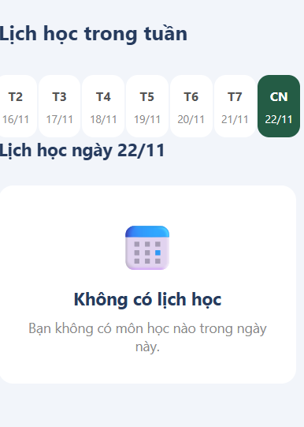

# BÀI THỰC HÀNH 06 - REACT NATIVE

## 1. Thông tin ứng dụng

- Tên ứng dụng: ScheduleApp
- Họ và tên: Huy Trần
- Chủ đề: Ứng dụng quản lý lịch học
- Nền tảng: Expo Snack

## 2. Link ứng dụng Expo

- ScheduleApp: https://snack.expo.dev/@huy228/scheduleapp

## 3. Cấu trúc thư mục

```text
ScheduleApp/
├── App.js
└── components/
    ├── Header.js
    ├── WeekSelector.js
    └── ScheduleCard.js
```

## 4. Nội dung các component

### 4.1. Header

- Hiển thị tên ứng dụng.
- Hiển thị tên sinh viên.
- Hiển thị lời chào.

### 4.2. WeekSelector

- Hiển thị 7 ngày trong tuần.
- Cho phép chọn ngày học.
- Ngày được chọn có màu sắc khác biệt.

### 4.3. ScheduleCard

- Hiển thị tên môn học.
- Hiển thị giờ học.
- Hiển thị phòng học.
- Hiển thị tên giảng viên.
- Sử dụng màu sắc để phân biệt các môn học.

## 5. Công nghệ sử dụng

- React Native
- View, Text
- TouchableOpacity
- ScrollView
- StyleSheet
- useState

## 6. Hình ảnh giao diện

### 6.1. Giao diện lịch học



### 6.2. Lịch học thứ Hai



### 6.3. Lịch học thứ Ba



### 6.4. Ngày không có lịch học



## 7. Kết luận

Hoàn thành bài thực hành xây dựng ứng dụng ScheduleApp bằng React Native.

Đã biết cách tạo giao diện lịch học, sử dụng component, chọn ngày và cập nhật danh sách môn học tương ứng.
