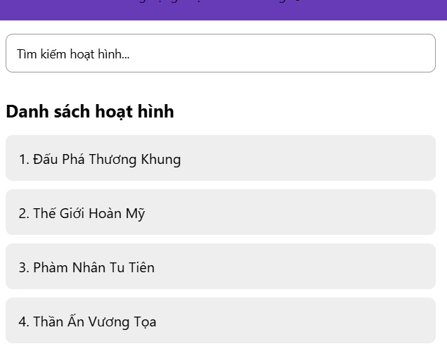
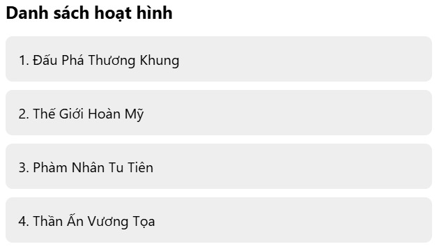
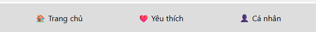
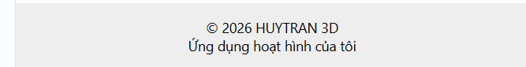
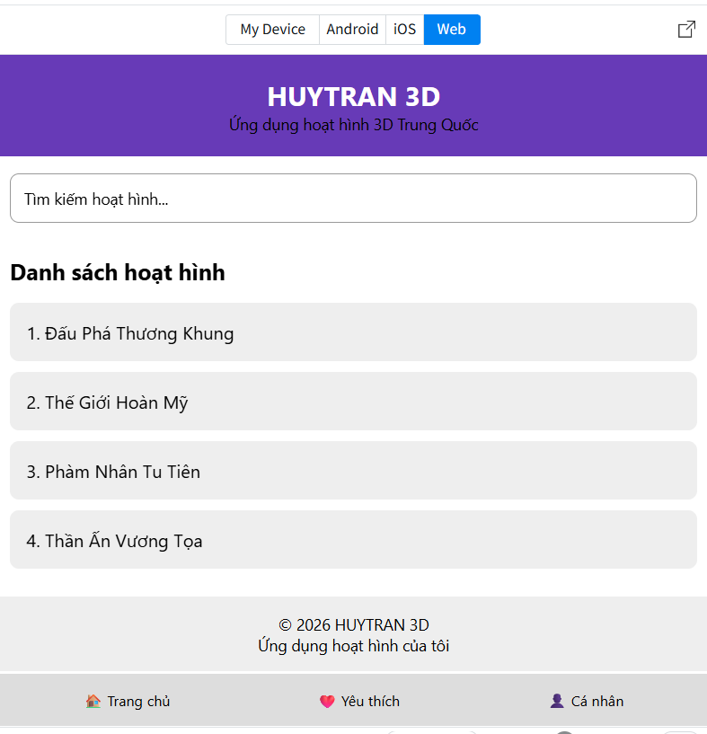

# BÀI THỰC HÀNH 01 - REACT NATIVE

## 1. Thông tin sinh viên

- Họ và tên: Huy Trần
- Tên ứng dụng: MyApp_V2
- Nền tảng: Expo Snack

## 2. Link ứng dụng Expo

- MyApp_V2: https://snack.expo.dev/@huy228/myapp_v2

## 3. Cấu trúc chương trình

```text
MyApp_V2/
├── App.js
├── Header.js
├── AddTask.js
├── TaskList.js
├── TabBar.js
└── Footer.js
```

## 4. Nội dung các Component

### 4.1. Header

- Chức năng: Hiển thị tên ứng dụng và tiêu đề.
- File: Header.js

### 4.2. AddTask

- Chức năng: Tạo ô nhập nội dung tìm kiếm hoạt hình.
- File: AddTask.js

### 4.3. TaskList

- Chức năng: Hiển thị danh sách các bộ hoạt hình.
- File: TaskList.js

### 4.4. TabBar

- Chức năng: Hiển thị thanh điều hướng gồm Trang chủ,
  Yêu thích và Cá nhân.
- File: TabBar.js

### 4.5. Footer

- Chức năng: Hiển thị thông tin cuối ứng dụng.
- File: Footer.js

## 5. Code chương trình

Các Component được chia thành những file riêng biệt
để dễ quản lý và chỉnh sửa.

File App.js sử dụng các câu lệnh import để gọi
các Component vào giao diện chính.

## 6. Hình ảnh giao diện

### Hình 1: Giao diện Header


### Hình 2: Giao diện AddTask



### Hình 3: Giao diện TaskList



### Hình 4: Giao diện TabBar



### Hình 5: Giao diện Footer



### Hình 6: Giao diện ứng dụng MyApp_V2 hoàn chỉnh



## 7. Kết luận

Hoàn thành bài thực hành React Native.

Đã biết cách tạo Component, chia Component thành
các file riêng biệt và sử dụng các Component trong
file App.js để xây dựng giao diện ứng dụng.

